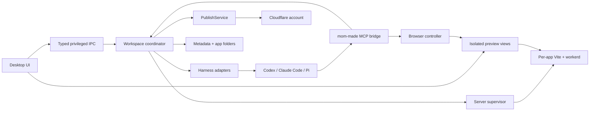

# mom-made — product and architecture

Design proposal · November 13, 2026

## 1. The product

mom-made is a local Mac studio for building small web applications through conversation. It owns the workspace, live previews, feedback, persistence, and publishing. A replaceable coding harness owns the model conversation and code editing loop.

One workspace has one persistent chat and several independent apps. An app is a folder, a supervised development process tree, a browser session, and an optional Cloudflare deployment. A route inside an app is not another server or tab.

The core loop is: describe → build → use → mark up → refine → publish. Code and local data survive quitting; running processes do not. Cloud deployments continue working after the Mac app quits.

## 2. The interface

Use a quiet, warm studio aesthetic: soft neutral chrome, a restrained terracotta accent, generous preview space, compact controls, system typography, and a lowercase wordmark. The generated app supplies most of the visual energy. Support dark appearance, keyboard operation, reduced motion, and readable contrast.

The main window has a native-feeling title bar, a resizable chat column about 340–400 points wide, and a large preview region. A small Studio / Skills switch lives in the application chrome; Settings uses the normal macOS menu and Cmd-comma. Avoid a second permanent navigation sidebar.

**Chat.** Persistent workspace transcript; compact tool activity such as “Edited 3 files” and “Checked the reservation form”; inline questions and permission requests; expandable diagnostics. The composer carries an explicit target chip, attachments, harness/model selection, and a reasoning control only when supported. Use named effort choices, not a fake continuous slider. Stop is always visible during a run. Context menu: Compact, New conversation, and conversation history. New conversation preserves files and archives the previous chat; it does not imply undo.

**Targeting.** By default the composer follows the selected app until submitted. Every submitted turn snapshots its app ID, attachments, selected skills, and harness settings. Switching tabs while a turn runs does not retarget it. Show “Working on Supper Club” independently of the viewed tab. A user can pin a different target or explicitly choose several apps. In v1, serialize editing turns across the workspace; multiple preview servers can run concurrently. This preserves the single-conversation idea without cross-app edit races.

**Preview.** Each tab is an app with a name and textual runtime state. A compact toolbar contains route, reload, viewport, Inspect, Markup, and Publish. Local/Live is explicit; agent interactions and markup default to Local. Errors become actionable preview states with View logs, Retry, and Ask agent to fix. A missing route is distinct from a crashed process. Logs and changes open on demand.

**Markup.** Freeze a screenshot of the current viewport and draw over it. Capture freehand circles, rectangles, pins, and a comment. The immutable capture makes coordinates dependable even if hot reload changes the live page. Submit the image plus structured context to chat; the agent edits the app and returns a fresh capture. Feedback moves Open → Addressed → Resolved; only the user resolves it, and can reopen it. A DOM anchor enriches a mark when available, but the screenshot remains the reference.

**Publish.** First use opens a compact setup sheet: account, app name, public destination, requested resources, and missing secrets. Later publishes use the saved destination. Show preparation, deployment, and verification progress, then the live URL and deployment history. A toolbar click or an explicit “publish this” message authorizes that publish. Pause only for changed destination, additional scope, destructive migration, or another new consequence. Let users enable unattended publishes per app/destination rather than nagging on every run.

**Skills.** A dedicated page shows installed skills, scope, source, and whether enabled. Selecting one opens its Markdown and supporting files. Create, import a folder, edit, reveal in Finder, and enable per workspace or app. Agents can write skills; show a diff and record the revision. Writes take effect on the next run/turn boundary, with explicit reload when needed. A skill edit cannot silently grant tool or cloud permissions.

**Settings.** Sections: Agents, Cloudflare, Files, Secrets, and Runtime. Show detected binaries and versions, login state, a connection test, chosen Cloudflare account/zone, and credential status without exposing tokens. File references default to read-only. Secrets have per-app local/production scope and set/missing states. Runtime settings include start behavior, limits, and diagnostics.

**Menu bar.** Show running apps, Open mom-made, Stop all local apps, and Quit. Closing the main window stops local app servers and active agent work, retaining only a lightweight tray presence. Reopening restores the previously open tabs and starts their servers. Cmd-Q exits everything. An optional “keep apps running when window closes” preference can come later; the default matches the requested lifecycle.

## 3. Opinionated technology choices

| Layer | Choice | Reason |
| --- | --- | --- |
| Desktop shell | Electron + React + TypeScript | Chromium previews, process control, native menus, and a shared language for adapters |
| App preview | Separate sandboxed WebContentsView per app | Browser content stays separate from privileged application UI |
| Local coordinator | TypeScript in a supervised utility process | Owns agent transports, app processes, and durable operations |
| Desktop metadata | SQLite, with transactional event writes | Durable sessions, app registry, annotations, and publish journal |
| Generated frontend | React + TypeScript + Vite; Tailwind and a small accessible component kit | One well-tested generation target |
| Generated backend | Hono API on a Cloudflare Worker | Small explicit HTTP backend, same-origin `/api/*` |
| Web hosting | Workers Static Assets + Worker | One deployment unit for frontend and API |
| Structured data | D1 when requested | SQL schema and checked-in migrations |
| Uploaded files | R2 when requested | Persistent object storage |
| Deployment | Pinned Wrangler and Cloudflare REST APIs behind PublishService | Reproducible operation shared by UI and agent |

Electron is an intentional footprint tradeoff. SwiftUI + WKWebView would improve native integration and distribution size, but introduces a second implementation language and WebKit-specific inspection/control work. Do not build two shells. Revisit this choice only if the browser-control/markup spike fails or measured resource use is unacceptable. Electron documents both [WebContentsView](https://www.electronjs.org/docs/latest/api/web-contents-view) and the necessary [renderer security boundaries](https://www.electronjs.org/docs/latest/tutorial/security).

The Cloudflare Vite plugin runs Worker code locally in workerd and supports frontend assets and HMR. Pin a tested stable toolchain and compatibility date in the template; updates should be deliberate. [Cloudflare Vite plugin](https://developers.cloudflare.com/workers/vite-plugin/)

Do not default to Next.js, containers, a resident Node/Express production server, or local filesystem persistence in generated backend code. Those complicate the intended deploy contract. SSR, Durable Objects, Queues, KV, and scheduled work can become explicit template capabilities later. Authentication for visitors is an app feature, separate from the builder's Cloudflare login; public hosting alone does not protect a private app.

## 4. System boundaries



The Electron main process owns windows, native dialogs, Keychain access, and browser views. It exposes narrow validated operations to the trusted shell. The coordinator owns orchestration and is restartable without losing the UI. Browser requests from it go through a typed main-process broker. Preview content receives no privileged preload bridge, filesystem access, or cloud credentials.

The MCP server is the agent's tool interface, not the chat transport. Harnesses have different event protocols. Normalize them internally instead of pretending MCP supplies a universal chat standard. Keep raw provider events available for local diagnostics, redact known secrets before persistence, and render a stable product event model.

## 5. Harnesses and authentication

| Harness | Integration | Auth and scope |
| --- | --- | --- |
| Codex, first | `codex app-server` over stdio; typed adapter for the pinned schema | Ask app-server for account state; reuse its supported local sign-in or invoke its browser login flow. Codex owns credentials. |
| Claude Code | Unmodified installed CLI with structured streaming; Agent SDK when API-key integration is selected | Existing sign-in remains owned by the official binary. Never copy subscription tokens into mom-made or Pi. |
| Pi | Long-lived RPC subprocess; SDK is an alternative if isolated within a helper | User-supplied provider key, including OpenRouter; pass only to the owning process. |

Codex exposes thread/turn lifecycle, streaming messages, interruption, compaction, approval requests, and account operations. Generate/check protocol types against the actual supported binary and expose model options from its catalog. [Codex app-server](https://learn.chatgpt.com/docs/app-server)

Claude Code supports programmatic structured output, while the SDK provides richer control. Its current documentation distinguishes running the unmodified binary with end-user authentication from offering a third-party Claude.ai login or intermediating subscription tokens. Use the official CLI path for bring-your-own installed Claude Code, preserve its authentication choices, and keep API-key SDK mode separate. Validate the distribution conditions before release; do not promise arbitrary subscription-token reuse. [Programmatic CLI](https://code.claude.com/docs/en/headless), [authentication and product conditions](https://code.claude.com/docs/en/legal-and-compliance)

Pi documents subprocess RPC and OpenRouter key support. Pin the supported release; use its MCP extension mechanism or a small owned bridge to expose mom-made tools. Do not assume every installed Pi release has identical MCP behavior. [RPC](https://github.com/badlogic/pi-mono/blob/main/packages/coding-agent/docs/rpc.md), [providers](https://github.com/badlogic/pi-mono/blob/main/packages/coding-agent/docs/providers.md), [extensions](https://github.com/badlogic/pi-mono/blob/main/packages/coding-agent/docs/extensions.md)

Each adapter reports capabilities: resume, cancel, compact, images, model discovery, effort levels, approval UI, and tool transport. Unsupported controls disappear. Acknowledging a prompt is not completion. Persist terminal success/failure/interruption separately.

The visible transcript belongs to mom-made; private harness sessions belong to their harness. Switching harness creates a new provider session with an explicit handoff summary, app paths, selected skills, and open feedback. It cannot preserve hidden context, caches, or reasoning state. Resume interrupted work only after user action; launching the app must not restart billable agent turns automatically.

## 6. Durable layout and local lifecycle

Proposed on-disk layout:

```text
~/Library/Application Support/mom-made/
  studio.sqlite
  logs/                       # bounded and redacted
  toolchains/                 # pinned runtime/deploy tooling
  skills/<skill-id>/SKILL.md  # canonical personal skill folders
  workspaces/<workspace-id>/
    workspace.json
    instructions/             # generated harness context
    attachments/              # reference copies, outside deployment roots
    captures/                 # screenshots and annotation payloads
    sessions/                 # app-owned pointers / supported harness state
    apps/<app-id>/
      mom-made.json           # versioned app manifest, no secrets
      package.json
      lockfile
      wrangler.jsonc
      src/                    # React frontend
      worker/                 # API
      migrations/
      public/                 # explicitly shipped assets
      .wrangler/state/        # durable local binding state, gitignored
      .mom-made/              # feedback and skill snapshots, excluded from deploy
```

Allow user-selected project locations later without changing app identity. IDs are stable UUIDs; names, paths, ports, and URLs can change. Workspace metadata records tab order and desired running state. App manifest records template version, binding declarations, secret names, and intended environments; cloud resource IDs are scoped by app + account + environment. Keep deployment credentials and private attachments out of source/export bundles.

Cloudflare's local binding state is persisted under `.wrangler/state` by default; dev and migration commands must point to the same state directory. Production bindings are separate resources. [Local data](https://developers.cloudflare.com/workers/local-development/local-data/)

Runtime state machine: stopped → starting → ready → stopping → stopped, with failed reachable from active states. Preview readiness requires a successful app health probe, not merely a spawned process. Allocate loopback ports with strict binding and retry on collision; record the actual port. Never kill an unknown process to free a port. Browser storage uses a persistent per-app partition; retain a preferred port when possible, and do not promise cookies/storage survive an origin change. Durable application data belongs in D1/R2, not browser storage alone.

A supervisor owns a process group for each app, drains bounded stdout/stderr, and tracks generation IDs. Shutdown interrupts the agent, stops new work, flushes metadata, sends graceful termination, then escalates after a bounded deadline. Kill only owned groups. A small watchdog tied to the main process lifetime handles parent death; PID start identity and ownership must be checked during recovery to avoid PID-reuse mistakes. Do not use detached daemons.

On reopen, restore all previously open apps with bounded parallel startup; focus the prior tab. Closing a tab stops its server and removes it from the reopen set, preserving the app in the library. Sleep/wake rechecks health without creating duplicate servers. Report crash loops and let the user repair/retry. Concurrent windows must share a single app-runtime owner.

## 7. Preview tools and feedback

The browser controller addresses a specific app/view and navigation generation, never “whatever tab is active.” Use Electron browser APIs and its debugger/CDP bridge against that exact WebContents; avoid launching a separate headless browser that lacks the user's cookies and state. Serialize actions per view, indicate agent control visibly, and let a human input cancel the control lease.

Initial MCP tools:

| Tool group | Operations |
| --- | --- |
| Apps | list, create from template, describe, start, stop, read logs |
| Browser | capture, inspect accessibility/DOM snapshot, navigate, click, type, scroll, read console/errors |
| Feedback | list, read capture/context, mark addressed with evidence |
| Files | list granted references, import selected assets, read approved references |
| Skills | list, read, propose/update skill within granted scope |
| Secrets | list names/status, request native secret entry; never return values |
| Publishing | prepare plan, publish authorized plan, status/history |

Every action takes app ID; browser actions additionally require a current navigation ID and stable element reference or captured coordinates. Re-resolve elements after navigation; stale targets fail visibly. Restrict navigation and control to owned app origins by default. External links open normally in the system browser. No internet-exposed debugging port.

An annotation contains app ID, source revision, URL, viewport size, device scale, scroll position, timestamp, screenshot ID, normalized geometry, comment, and optional element attributes/accessibility label. A source file mapping is best-effort, not a guarantee for arbitrary DOM. Cross-origin iframes may be screenshot-only. Avoid capturing passwords or irrelevant account pages.

Native WebContentsView stacking matters: HTML in the shell cannot simply float above another native view. For markup, capture then temporarily hide/detach the live view and render the frozen image and drawing controls in the shell's preview region. On exit, restore the live view and its bounds. This also prevents drawing gestures from clicking the app underneath.

## 8. Cloudflare and publishing

Cloudflare connection has two independent capabilities: deployment credentials used by PublishService, and MCP authorization used by the agent. Detect an existing supported Wrangler login without reading/displaying its token; alternatively accept a scoped API token into Keychain. Check the selected account and required permissions before presenting Connected. Use the official CLI login for the prototype; do not invent an OAuth client or assume MCP OAuth credentials are interchangeable with Wrangler credentials.

Mount the official Cloudflare documentation MCP. Offer the API MCP as a separately authorized connection with explicit permission scope. Current endpoints and OAuth behavior are documented by [Cloudflare's MCP servers](https://developers.cloudflare.com/agents/model-context-protocol/cloudflare/servers-for-cloudflare/). Mutating deployment paths should go through mom-made's PublishService so agent and button produce identical records. A broadly authorized Cloudflare API MCP can bypass that workflow; label it Advanced, keep its permissions narrow by default, and do not claim local publish policy constrains external write tools.

Publishing is a durable, retryable operation:

1. Snapshot source and lockfile into an immutable staging directory; record content hash. Later agent edits belong to the next publish.
2. Typecheck/test/build with a pinned runtime, without deployment credentials in the build process. Validate declared bindings and required secret names. Report unexpected artifacts or undeclared capabilities.
3. Prepare an exact plan for account, environment, Worker, bindings, migrations, and hostname. Names include stable app identity to avoid collisions. A saved mapping, not display name guessing, identifies existing resources.
4. Honor existing authorization or request only newly required scope. Reconcile resources using stored IDs and an operation journal. Retry must not create duplicate databases/buckets.
5. Configure secrets and apply approved backward-compatible schema changes to the named production database. No automatic local database or user-upload copy.
6. Deploy the immutable built Worker and static assets using the recorded resource mapping; preserve existing secrets. For first deployment, keep an incomplete app non-public until required secrets are configured.
7. Verify live static content, API health, and app-specific smoke checks. Configure the optional custom hostname and report DNS/certificate readiness separately.
8. Record deployment/version IDs, source hash, migration set, timestamp, URL, and verification outcome. A post-deploy verification failure is “deployed, verification failed,” not “nothing changed.” Reconcile interrupted operations on next launch rather than blindly retrying.

Use a workers.dev destination initially. Custom domains require an active zone and an available hostname; never overwrite unrelated DNS automatically. [Custom domains](https://developers.cloudflare.com/workers/configuration/routing/custom-domains/)

Cloud resource mutation is not one transaction. D1 migration history is tracked independently, and reverting code does not revert user data. Default to additive migrations; destructive changes require a separate plan with recovery steps. Record partial resources on failure and do not delete potentially populated resources during automatic cleanup. [D1 migrations](https://developers.cloudflare.com/d1/reference/migrations/), [Worker rollback limitations](https://developers.cloudflare.com/workers/versions-and-deployments/rollbacks/)

## 9. Secrets, file references, and skills

Use macOS Keychain for mom-made-managed secrets. The agent asks for a named secret and the user enters it in native app UI, outside chat. Bind the value to the server runtime; browser code only gets a server endpoint. Never place it in a `VITE_*` variable, transcript, generated skill, manifest, command-line argument, or exported source. Local and production values can differ. Pass deployment secret payloads over stdin or a narrowly scoped API request; redact error bodies and logs.

Default to per-Worker encrypted secret bindings. Add account-level Secrets Store as an optional reusable-secret backend; it is currently documented as open beta, so it should not be a prerequisite. [Worker secrets](https://developers.cloudflare.com/workers/configuration/secrets/), [Secrets Store](https://developers.cloudflare.com/secrets-store/)

Dropping a file into chat creates a private reference snapshot. “Add to app” explicitly copies it into the deployment source tree. A folder grant is read-only unless the user selects write access. Canonicalize paths, reject traversal and symlink escapes, and show provenance. External reference content is untrusted input to the agent.

Skills use ordinary folders with `SKILL.md` plus references/scripts/assets. Maintain canonical personal skills and app-specific skills; create versioned snapshots for runs and adapt discovery paths for each harness. Avoid modifying the user's global agent configuration. Store permissions separately from skills. Script-bearing skills can execute code through the harness; importing one does not automatically authorize it.

## 10. Trust and practical limits

This is initially a trusted local developer tool. A working directory, MCP scope, or ignored file is not an OS sandbox. Coding agents, package installation, and generated backend scripts can execute code as the user. Harness restrictions vary and must be presented honestly. A stronger isolation promise requires a separate sandbox/VM design and should gate unattended execution of unknown projects. Cloudflare explicitly notes that [local Miniflare is not a hardened sandbox](https://developers.cloudflare.com/workers/local-development/).

Separate the browser boundary from this execution boundary: generated pages have Node disabled, context isolation and sandbox enabled, per-app browser partitions, no privileged preload, constrained navigation/popups/downloads, and explicit permission handlers. IPC validates sender identity and arguments. Use a stdio MCP shim talking to a private per-run local channel; do not expose a permissive localhost HTTP admin API that arbitrary pages could call.

Keep deployment credentials out of agent and build environments. Secret redaction prevents accidental display but cannot make secrets unknowable to generated server code that must consume them. An app runtime is authorized to use its own runtime secrets; Cloudflare account credentials are never one of those secrets.

The Mac app is local-first, not offline AI: selected content goes to the chosen model provider, and published files go to Cloudflare. Distribution is a signed/notarized direct-download app, with bundled or managed pinned runtime tooling. Do not depend on Finder launches inheriting a developer's terminal PATH or a global Node installation.
