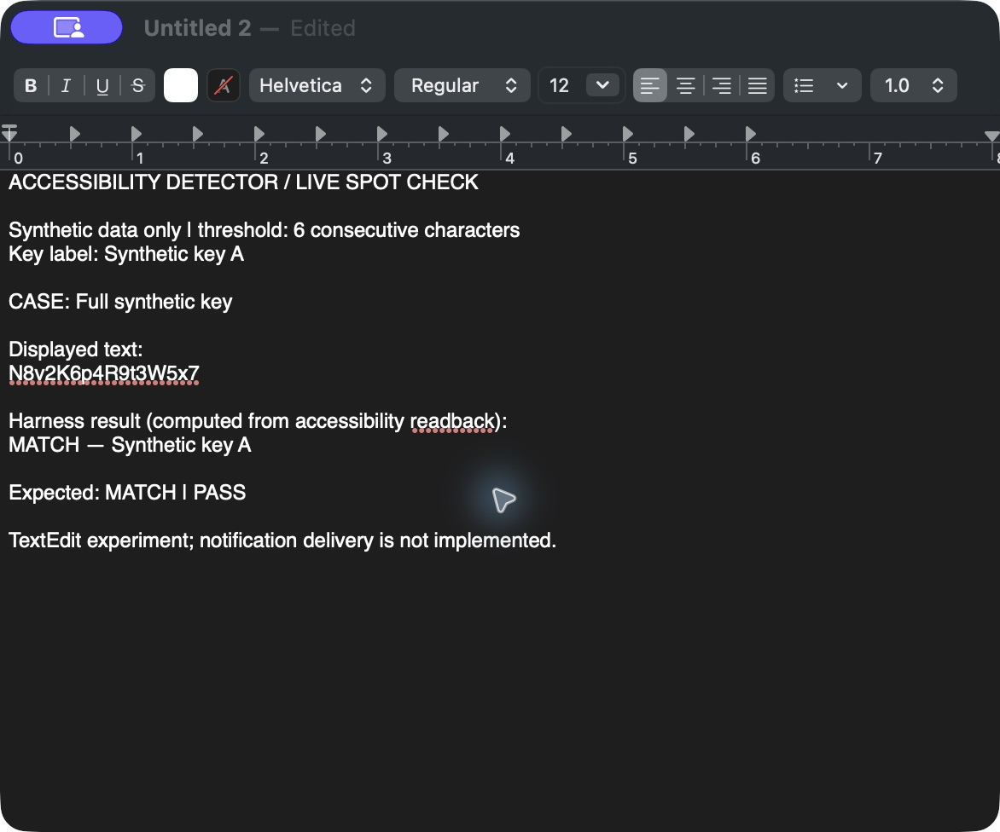

# Accessibility detector demo

[Watch the TextEdit demo (MP4, 26 seconds)](textedit-demo.mp4)

Recorded November 12, 2026 on the user's Mac. The video is assembled from 45 timestamped captures of the actual TextEdit window. It is a low-frame-rate window capture, with no audio. All 46 encoded video frames (including the closing duplicate frame) were decoded successfully for verification.

The harness writes synthetic text into a dedicated TextEdit document, reads a fresh full accessibility snapshot, and searches that snapshot using the precomputed six-character fragments of a synthetic secret. It then writes the computed result into the document for the viewer. These results are calculated during the experiment; the displayed result is a harness presentation, not an operating-system notification or a completed monitoring app.

| Case | Expected | Observed |
| --- | --- | --- |
| Unrelated text | No match | No match |
| Five consecutive characters | No match | No match |
| Six consecutive characters | Match | Synthetic key A |
| Fragment interrupted by a space | No match | No match |
| Full synthetic key | Match | Synthetic key A |

[Machine-readable results](results.json) · [Spot-check findings](../../detector-spot-check.md) · [Architecture investigation](../../stream-redactor.md)

Only synthetic data appears in the recording. No OCR or LLM performs the matching. This validates native text extraction and fragment matching in TextEdit. Terminal access was blocked by the computer-use tool's app policy, so Terminal support, standalone Accessibility authorization, notification delivery, visible-range filtering, and continuous monitoring still need validation.

For app access, the official [Computer Use setup instructions](https://developers.openai.com/training/walkthroughs/using-your-computer-and-browser) describe Settings → Computer use. The documentation does not establish that the specific Terminal safety restriction can be overridden.
