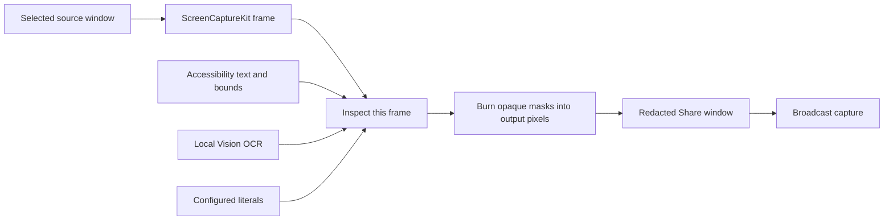

# macOS stream redactor: feasibility and implementation design

Research date: November 11, 2026. Status: design and API review, not a tested implementation.

The substring matcher is straightforward. The difficult parts are obtaining complete text, locating its pixels, and ensuring masking happens before a viewer receives those pixels. A useful prototype is a reasonable one-pass build. A universal, leak-free desktop redactor is not a defensible one-pass promise.

## What macOS provides

Accessibility exposes the semantic information each application supplies. It is not a complete transcription of everything drawn on screen. Apple documents additional implementation work for custom controls; applications can also report unsupported attributes. This matters for terminals, custom editors, images, and canvas-rendered text. See [Apple's accessibility integration guide](https://developer.apple.com/documentation/accessibility/integrating-accessibility-into-your-app) and [unsupported parameterized attributes](https://developer.apple.com/documentation/applicationservices/axerror/parameterizedattributeunsupported).

Where supported, `AXBoundsForRange` supplies a rectangle for a text range. That makes exact substring masks possible without OCR. Read visible text, find matches, convert their ranges to AX ranges, request rectangles, and cover those rectangles. See [Apple's text-range bounds API](https://developer.apple.com/documentation/applicationservices/kaxboundsforrangeparameterizedattribute).

Accessibility setters change an application's exposed attributes; they do not provide a global replacement function for rendered glyphs. Writing `***` into a text field can modify its actual value. Our redactor should read accessibility data only and draw its own output. See [AXUIElementSetAttributeValue](https://developer.apple.com/documentation/applicationservices/1460434-axuielementsetattributevalue).

ScreenCaptureKit supplies image buffers for capture processing and filters at display, application, and window granularity. Substring masking would be our processing stage, not an `SCContentFilter` feature. See [SCStreamOutput](https://developer.apple.com/documentation/screencapturekit/scstreamoutput) and [SCContentFilter](https://developer.apple.com/documentation/screencapturekit/sccontentfilter).

Apple Vision can recognize text locally and return substring bounds. It offers broader pixel coverage, but recognition is fallible, particularly for arbitrary secret strings. See [Recognizing Text in Images](https://developer.apple.com/documentation/vision/recognizing-text-in-images).

Engineering conclusion from these API boundaries: the documented interfaces support observing, covering, and processing captured content. They do not give an ordinary third-party app a universal pre-render text interception hook.

## Three possible products

| Product | How it works | Protection boundary | First-build assessment |
| --- | --- | --- | --- |
| Desktop overlay | AX lookup plus click-through opaque panels over matches | Best-effort visual concealment | Small prototype; unsuitable as the only stream protection |
| Processed sharing window | Capture, inspect, burn masks into each output image, publish a dedicated window | Only the processed output; detection remains fallible | Useful one-pass prototype with a narrow source and measured performance |
| Protected terminal | Parse terminal output into a grid; mask before rendering that grid | Supported terminal text and configured secrets | Strongest fit for Claude Code; requires an existing terminal engine and careful validation |

An overlay has two structural problems. It reacts after the source can draw, creating a possible leak interval. Also, a window-only capture can capture the underlying source without a separate overlay window. A faster polling interval does not remove either problem.

## Desktop prototype design

Build a native Swift/AppKit app with a menu-bar controller, a local literal-secret list, one selected source window, and a dedicated output window named “Redacted Share.” Start with a terminal as the source and no audio. The user works in the original window and broadcasts only the processed output window.

Implementation modules:

1. `SecretStore`: explicit local configuration, never real secrets in command arguments or logs. Case-sensitive literal matching by default. Reject empty patterns and deduplicate. Keep the configuration UI outside the published output. Updating the list invalidates previously approved output.
2. `CaptureSession`: one source window, bounded frame queue, fresh frame IDs and source generations. Capture only the source so the output cannot recursively capture itself. Changing source clears pending frames.
3. `AXTextLocator`: bounded traversal and visible-range queries, timeouts, observers where supported, polling fallback. Gather text and range geometry without editing the source. Unsupported or stale results are unknown, not a clean bill of health.
4. `FrameInspector`: OCR the actual image being processed when using the pixel-based mode. AX results can help locate candidates, but AX and capture have no atomic shared snapshot; AX alone cannot certify that a particular captured frame is safe. Keep source image, result, and masks tied to the same frame ID.
5. `MaskRenderer`: opaque fill with a small margin around glyph bounds, optionally draw asterisks on top. Do not merely draw asterisks over readable pixels or use blur. Map screen coordinates, window content offsets, scaling, and image coordinates explicitly. Mask the whole line or element if a known match lacks reliable substring geometry.
6. `OutputGate`: starts with a placeholder; publishes only completed processed frames. On timeout, revoked access, invalid source, or known uncertainty, retain the last processed frame or display a placeholder. Drop overloaded frames instead of passing them through raw. Never attach an unprocessed recording output.

The processing gate prevents accidental bypass and timing races in our pipeline. It cannot detect an OCR false negative that appears to be a successful recognition result. “No matches found” is not proof that a frame contains no secret. A stricter mode can hide entire configured regions/windows regardless of recognition, at the expense of visibility.

For speed, begin with a small literal list and straightforward scans. A compiled multi-pattern matcher such as Aho–Corasick is justified only if measurement shows matching matters. AX cross-process calls, OCR, image processing, and capture are likely to dominate; that is a hypothesis to benchmark, not a performance result. Set an initial experiment target of 1080p at 10–15 processed frames per second. Measure achievable latency and CPU/GPU use before increasing it. Delay alone does not repair missed recognition or stale AX coordinates.

This mode requires screen-capture authorization and, for AX assistance, Accessibility authorization. Its source still contains the original text. Direct desktop sharing, other captures, clipboard contents, files, and spoken secrets are outside this output's protection boundary.

## Terminal-first design for stronger protection

For Claude Code, prefer an existing terminal emulator component with a controllable rendering stage:

`PTY → terminal parser → private terminal grid → literal matcher and mask map → visible terminal renderer`

The subprocess retains its real data; masks change only the public presentation. Match logical text across soft-wrapped rows and map matches back to cells. Process ANSI styles, cursor movement, redraws, alternate screens, Unicode, and resizing before matching. Maintain a separate private grid so redaction does not corrupt terminal behavior. Apply the same policy to scrollback, selection rendering, and window titles; disable unsupported image output in the initial protected mode.

A simple `claude | sed ...` wrapper is insufficient for an interactive terminal: output can arrive in chunks, escape sequences can interrupt apparent strings, and cursor operations can assemble a secret at a different screen position.

Partial secrets need an explicit policy. If a key arrives character by character, its prefix could become visible before the full literal matches. A strict mode must conservatively mask possible prefixes while incomplete (with false positives), or suppress publication of unsettled text until ambiguity is resolved. A fixed delay is not sufficient if output stalls indefinitely. This remains protection for configured representations, not unknown, encoded, or arbitrarily transformed secrets.

Terminal implementation is the more deterministic boundary, but engine selection and its render hooks must be inspected before promising a one-pass robust build. It does not protect a browser, editor, notification, or another terminal window.

## Acceptance criteria and first experiment

Use synthetic secrets only. The first experiment should measure the intended terminal's AX text coverage, range bounds, notification behavior, and reaction latency. Repeat with a native text control and a browser as comparison sources. If a matching range is unsupported, record a capability failure rather than inferring success from an empty result.

Record and inspect the actual published output, not just what the operator sees. Exercise:

- Secret shown for one frame; rapid scrolling, window moves, and resizing.
- Repeated and overlapping literals, soft wraps, split output chunks, and non-ASCII text before a match.
- Selection, search highlights, scrollback, alternate-screen redraws, and terminal titles.
- Retina scaling, a second display, source switching, and permission revocation.
- Slow or failed inspection, queue overload, app restart, and secret-list updates.

Pass criterion for the defined synthetic cases: no unmasked secret pixels in any emitted frame, with uncertainty causing a placeholder or preserved processed frame. An independent pixel/fixture-based check is needed; reusing the same OCR recognizer for validation could repeat its misses. Passing finite cases supports the tested scope, not universal coverage.

## Investigation limits and recommendation

Reviewed Apple's current documentation and the installed macOS SDK declarations. No live accessibility probe, recording, latency measurement, or terminal integration was performed. The referenced tracker was not found in the inspected workspace or the few adjacent projects searched, so code reuse is unconfirmed. The local `mail/` project is an unrelated agentic email application.

Proceed with a one-pass desktop demonstration if the goal is to explore the interaction. For dependable protection during Claude Code streaming, start with the terminal rendering boundary and a small, explicitly tested secret policy. Do not market an AX overlay or OCR pipeline as “all text, all apps, zero leaks.”
