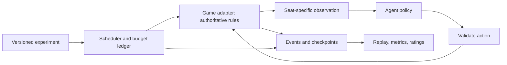

# Social Arena: research spike

**Decision proposed:** build a small, reproducible harness for agent games. Start with Avalon; use Dominion as the second adapter to discover which primitives actually generalize.

**Status:** design only, 2026-11-08. No game engine or paid model runs in this spike. Read this page first (~3 minutes); [ratings](RATINGS.md) answers the Elo question; [execution](EXECUTION.md) is the handoff for implementation. [Sources](SOURCES.md) records what was checked.

## What we want to learn

Measure how agent policies cooperate, persuade, infer hidden information, and make strategic decisions against other policies. A useful result combines **outcome, uncertainty, cost, and a replay explaining what happened**. The rating belongs to a particular model, prompt, memory policy, and compute budget in a particular environment.

Dwarkesh's Clocktower project is the starting reference. His video companion discusses coordinated deception, collective deduction, memory, mixed teams, and stronger individual teammates. We read that companion rather than extracting YouTube captions. [Essay and video](https://www.dwarkesh.com/p/clocktower).

Our first research question: **does a stronger agent improve a team's decisions, and does that depend on its role?** First establish reliable homogeneous-team comparisons; then replace one seat while holding the rest of the experiment fixed.

## The smallest useful platform

| Primitive | Responsibility |
| --- | --- |
| Game adapter | Setup, legal decisions, visibility, transitions, terminal outcomes. No model calls. |
| Agent policy | Act on one seat's permitted information; interchangeable scripted and model-backed agents. |
| Experiment runner | Assign policies to seats, pair scenarios, schedule calls, enforce spend limits, resume. |
| Event record | Preserve actions, observations, randomness, failures, usage, and versions for exact playback. |
| Evaluator | Compute outcomes and game-specific diagnostics; fit ratings separately from gameplay. |

Use Python, typed records, JSON experiment files, and append-only JSONL logs initially. Keep the core independent of any provider SDK. Use an existing game engine if a short correctness/license review supports it; do not make a Clocktower fork the universal engine. Its code remains a useful reference for protocols, rating fits, and experiment design. [Upstream implementation](https://github.com/dwarkeshsp/clocktower).

## Two games, deliberately different

| | Avalon v1 | Dominion v2 |
| --- | --- | --- |
| Purpose | Social inference and team coordination | Strategic planning and resource allocation |
| Scope | 5 seats: Merlin, 2 loyal servants, Assassin, 1 minion | 2 players; base second edition; one fixed 10-card kingdom |
| Hidden information | Roles and private quest contributions | Hands and deck order |
| Decisions | Speech, team proposals, simultaneous votes, quests, final assassination | Card play, buys, discards, reactions, nested card choices |
| Rating unit | Policy filling a whole alignment | Policy controlling one player |
| Generalization test | Visibility and simultaneous decisions | Variable action spaces and interrupted turns |

Avalon has no mid-game elimination; retain its terminal Merlin-assassination rule. Use public discussion only. Dominion begins with the publisher's “First Game” kingdom, including Militia/Moat to exercise reactions. These are proposed benchmark scopes, with rules sourced in [the source notes](SOURCES.md).

## First experiments

| Order | Question | Comparison and primary readout |
| --- | --- | --- |
| 0 | Can we trust the harness? | Scripted/random agents; legal play, isolation, deterministic replay. No capability claims. |
| 1 | Which team policy wins? | A-good/B-evil and reversed on matched setups; adjusted rating, side win rates, uncertainty, cost. |
| 2 | Does one stronger seat help? | Paired baseline/intervention; rotate the replaced role; team win-rate uplift by role. |
| 3 | Does discussion help deduction? | Fixed discussion budget versus no speech; win rate and private belief accuracy. |
| Later | Memory, diverse teams, strategy transfer? | Separate registered experiments after the first three work. |

Belief accuracy is diagnostic, never a substitute for winning. Separate Merlin's informed beliefs from uninformed good seats. Hold out scenarios for evaluation; do not tune prompts on the reported test games.

## Review target and boundaries

The first release should produce one inspectable Avalon experiment folder with a manifest, complete replays, failure/cost accounting, and a report with uncertainty. A reviewer must be able to inspect exactly what a player knew at any decision.

Defer a hosted service, human multiplayer, training, arbitrary game import, cross-game rankings, and large tournaments. Paid runs happen later in the work environment; the default local configuration spends **$0**.

The main choices to review are the five-player Avalon scope, whole-team ratings before individual attribution, and whether the first paid study should prioritize team rankings or one-seat uplift. Everything else is an implementation default in the [execution plan](EXECUTION.md).
